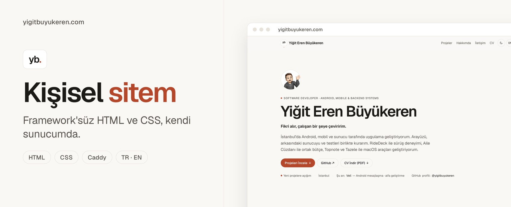

<a href="https://yigitbuyukeren.com">
  <picture>
    <source media="(prefers-color-scheme: dark)" srcset=".github/banner-dark.jpg">
    
  </picture>
</a>

<div align="center">

**[🌐 Siteyi aç](https://yigitbuyukeren.com)** &nbsp;·&nbsp; **[🇬🇧 English](https://yigitbuyukeren.com/en/)** &nbsp;·&nbsp; **[🏍️ RideDeck](https://yigitbuyukeren.com/ridedeck/)** &nbsp;·&nbsp; **[🌿 Aile Cüzdanı](https://yigitbuyukeren.com/aile-cuzdani/)**

[](https://yigitbuyukeren.com)


[](https://github.com/yigitbuyukeren/yigitbuyukeren.github.io/commits/main)

</div>

Kişisel sitemin kaynak kodu. **Build adımı yok, framework yok:** düz HTML, tek bir CSS ve tek bir JavaScript dosyası. Fontlar da sitenin içinde, ziyaretçinin tarayıcısı Google'a ya da başka bir CDN'e istek atmaz.

| ⚡ **Hafif** | 🌗 **Açık ve koyu tema** | 🟠 **Kil arayüzü** | 🔒 **İzleyici yok** |
|:---:|:---:|:---:|:---:|
| Tek CSS, tek JS, framework yok | Sistem temasına uyar, elle de değişir | Açık sıcak zemin, terracotta vurgu, tek yazı tipi Geist | Fontlar sitede, izleme, reklam ve dış istek yok |

### 🗺️ Sayfalar

| Sayfa | |
|---|---|
| [`/`](https://yigitbuyukeren.com) · [`/en/`](https://yigitbuyukeren.com/en/) | Ana sayfa: hero, hizmetler, öne çıkan projeler, teknik çalışmalar, diğer projeler, süreç, hakkımda, yaklaşım, teknolojiler, sertifikalar ve açık kaynak, SSS, iletişim formu |
| [`/cv/`](https://yigitbuyukeren.com/cv/) · [`/en/cv/`](https://yigitbuyukeren.com/en/cv/) | Özgeçmiş sayfası ve tek sayfalık PDF'ler (`Yigit-Eren-Buyukeren-CV-TR.pdf`, `-EN.pdf`) |
| [`/ridedeck/`](https://yigitbuyukeren.com/ridedeck/) · [`/en/ridedeck/`](https://yigitbuyukeren.com/en/ridedeck/) | RideDeck proje sayfası |
| [`/aile-cuzdani/`](https://yigitbuyukeren.com/aile-cuzdani/) · [`/en/aile-cuzdani/`](https://yigitbuyukeren.com/en/aile-cuzdani/) | Aile Cüzdanı proje sayfası, [gizlilik](https://yigitbuyukeren.com/aile-cuzdani/gizlilik/), [şartlar](https://yigitbuyukeren.com/aile-cuzdani/sartlar/) ve [hesap silme](https://yigitbuyukeren.com/aile-cuzdani/hesap-silme/) |
| [`/veil/`](https://yigitbuyukeren.com/veil/) · [`/en/veil/`](https://yigitbuyukeren.com/en/veil/) | Veil: SimpleX tabanlı Android istemcisi, alfa hedefleri ve doğrulama sınırları |
| [`/dogum-gunu/`](https://yigitbuyukeren.com/dogum-gunu/) | [Doğum Günü Sürprizi](https://github.com/yigitbuyukeren/dogum-gunu-surprizi)'nin canlı demosu |

### 🧱 Yapı

```text
index.html, en/                ana sayfa (TR / EN)
ridedeck/, en/ridedeck/        RideDeck proje sayfaları
veil/, en/veil/                Veil proje ve geliştirme durumu
aile-cuzdani/                  proje sayfası ve yasal metinler
dogum-gunu/                    canlı demo
assets/home.css                ana sayfa tasarımı ("Kil": renkler, tipografi, bileşenler)
assets/home.js                 ana sayfa hero arkasındaki canlı leke animasyonu
assets/site.css                diğer sayfaların stil dosyası (renkler, açık/koyu tema)
assets/site.js                 tema düğmesi, mobil menü, bölüm işareti, belirme ve form
assets/fonts/                  Geist + Fraunces (latin + Türkçe karakterler)
assets/img/                    ekran görüntüleri, paylaşım görselleri, ikonlar
404.html, sitemap.xml          hata sayfası ve hreflang'li site haritası
deploy.sh                      sunucuya gönderme
cv/, en/cv/                    CV sayfaları ve PDF'ler (tools/cv/build-cv.py ile üretilir)
tools/                         cv üretici (HTML + PDF) ve site kontrolü; yayına girmez
```

CV içeriği tek yerde, `tools/cv/build-cv.py` içinde durur; TR/EN sayfalar ve PDF'ler oradan üretilir (`python3 tools/cv/build-cv.py`, PDF için macOS gerekir). Bağlantı, meta ve görsel kontrolü: `python3 tools/check-site.py`.

### 🚀 Yerelde çalıştırma ve yayınlama

```bash
python3 -m http.server 8000      # http://localhost:8000
bash deploy.sh                   # rsync ile VPS'e gönderir; Caddy /var/www altından sunar
```

### İçeriği güncelleme

- Ana sayfa ve proje sayfaları Türkçe/İngilizce birlikte güncellenir.
- Test sayıları tarihli doğrulama kayıtlarına dayanır; kaynak kod, indirilebilir sürüm ve sunucu durumu ayrı belirtilir.
- CV değişiklikleri `tools/cv/build-cv.py` içinde yapılır; HTML ve PDF birlikte yeniden üretilir.
- `python3 tools/check-site.py` bağlantıları, sayfa metalarını ve site haritasını denetler.
- Profil kartları, ayrı profil deposundaki `tools/render.sh` ile bu sitenin kartlarından üretilir.

Asıl adres **yigitbuyukeren.com**, kendi sunucumda Caddy ve otomatik HTTPS ile sunulur; VPS yayını `deploy.sh` ile ayrıca yapılır. GitHub Pages aynası kapatıldı; `yigitbuyukeren.github.io` artık yayında değil (404). Canonical bağlantılar asıl alan adını gösterir. `deploy.sh` `.git`, `.github` ve README gibi yayına girmeyecek dosyaları atlar.

<details>
<summary><h3>🇬🇧 English</h3></summary>

Source of my personal site, [yigitbuyukeren.com](https://yigitbuyukeren.com). **No build step, no framework:** plain HTML, one stylesheet and one script. Fonts are served from the site itself, so visitors' browsers make no requests to Google or any other CDN. Light and dark themes follow the system and can be switched by hand; the warm, minimal interface uses a single terracotta accent and the Geist typeface.

Pages: home (Turkish and English), RideDeck (Turkish and English), Aile Cüzdanı with its privacy, terms and account-deletion pages, Veil with its alpha status and verification limits, CV pages with downloadable PDFs, and the live demo of the Birthday Surprise. Run it locally with `python3 -m http.server`; `deploy.sh` rsyncs it to a VPS where Caddy serves the primary domain over HTTPS. The GitHub Pages mirror is disabled; yigitbuyukeren.github.io is no longer served (404), and pushing to GitHub does not update the VPS.

</details>
