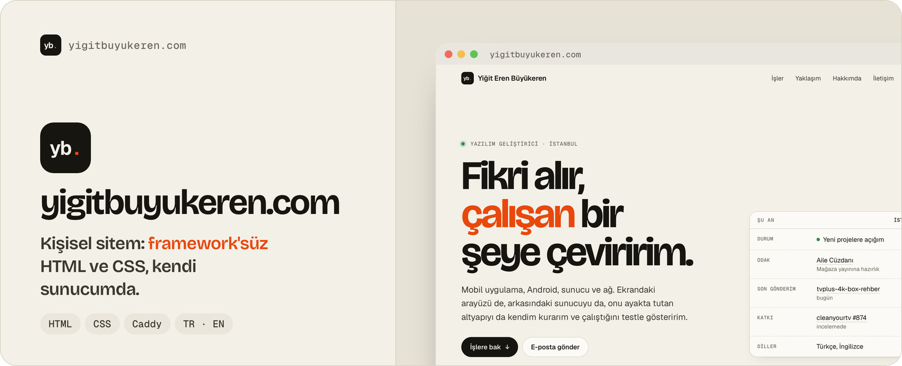

<a href="https://yigitbuyukeren.com">
  <picture>
    <source media="(prefers-color-scheme: dark)" srcset=".github/banner-dark.jpg">
    
  </picture>
</a>

<div align="center">

**[🌐 Siteyi aç](https://yigitbuyukeren.com)** &nbsp;·&nbsp; **[🇬🇧 English](https://yigitbuyukeren.com/en/)** &nbsp;·&nbsp; **[🏍️ RideDeck](https://yigitbuyukeren.com/ridedeck/)** &nbsp;·&nbsp; **[🌿 Aile Cüzdanı](https://yigitbuyukeren.com/aile-cuzdani/)**

[](https://yigitbuyukeren.com)


[](https://github.com/yigitbuyukeren/yigitbuyukeren.github.io/commits/main)

</div>

Kişisel sitemin kaynak kodu. **Build adımı yok, framework yok:** düz HTML, tek bir CSS ve tek bir JavaScript dosyası. Fontlar da sitenin içinde, ziyaretçinin tarayıcısı Google'a ya da başka bir CDN'e istek atmaz.

| ⚡ **Hafif** | 🌗 **Açık ve koyu tema** | 🔴 **Canlı "Şu an" paneli** | 🔒 **Üçüncü taraf yok** |
|:---:|:---:|:---:|:---:|
| Tek CSS, tek JS, framework yok | Sistem temasına uyar, elle de değişir | İstanbul saati, son gönderilen repo ve PR durumu GitHub'dan | Fontlar sitede, izleme ve reklam yok |

### 🗺️ Sayfalar

| Sayfa | |
|---|---|
| [`/`](https://yigitbuyukeren.com) · [`/en/`](https://yigitbuyukeren.com/en/) | Ana sayfa: seçili işler, yaklaşım, araçlar, hakkımda, iletişim |
| [`/ridedeck/`](https://yigitbuyukeren.com/ridedeck/) · [`/en/ridedeck/`](https://yigitbuyukeren.com/en/ridedeck/) | RideDeck proje sayfası |
| [`/aile-cuzdani/`](https://yigitbuyukeren.com/aile-cuzdani/) | Aile Cüzdanı proje sayfası, [gizlilik](https://yigitbuyukeren.com/aile-cuzdani/gizlilik/), [şartlar](https://yigitbuyukeren.com/aile-cuzdani/sartlar/) ve [hesap silme](https://yigitbuyukeren.com/aile-cuzdani/hesap-silme/) |
| [`/dogum-gunu/`](https://yigitbuyukeren.com/dogum-gunu/) | [Doğum Günü Sürprizi](https://github.com/yigitbuyukeren/dogum-gunu-surprizi)'nin canlı demosu |

### 🧱 Yapı

```text
index.html, en/                ana sayfa (TR / EN)
ridedeck/, en/ridedeck/        proje sayfası
aile-cuzdani/                  proje sayfası ve yasal metinler
dogum-gunu/                    canlı demo
assets/site.css                bütün sayfaların tek stil dosyası (renkler, açık/koyu tema)
assets/site.js                 tema düğmesi, İstanbul saati, GitHub'dan canlı bilgiler
assets/fonts/                  Bricolage Grotesque, Geist, Geist Mono (latin + Türkçe karakterler)
assets/img/                    ekran görüntüleri, paylaşım görselleri, ikonlar
404.html, sitemap.xml          hata sayfası ve hreflang'li site haritası
deploy.sh                      sunucuya gönderme
```

### 🚀 Yerelde çalıştırma ve yayınlama

```bash
python3 -m http.server 8000      # http://localhost:8000
bash deploy.sh                   # rsync ile VPS'e gönderir; Caddy /var/www altından sunar
```

GitHub Pages kullanılmıyor; site kendi sunucumda Caddy ile, otomatik HTTPS ile yayında. `deploy.sh` `.git`, `.github`, `.local` ve README gibi yayına girmeyecek dosyaları atlar.

<details>
<summary><h3>🇬🇧 English</h3></summary>

Source of my personal site, [yigitbuyukeren.com](https://yigitbuyukeren.com). **No build step, no framework:** plain HTML, one stylesheet and one script. Fonts are served from the site itself, so visitors' browsers make no requests to Google or any other CDN. Light and dark themes follow the system and can be switched by hand; a live "right now" panel shows the Istanbul time, the last pushed repository and a pull request's state from the GitHub API.

Pages: home (Turkish and English), RideDeck (Turkish and English), Aile Cüzdanı with its privacy, terms and account-deletion pages, and the live demo of the Birthday Surprise. Run it locally with `python3 -m http.server`; `deploy.sh` rsyncs it to a VPS where Caddy serves it over HTTPS.

</details>
